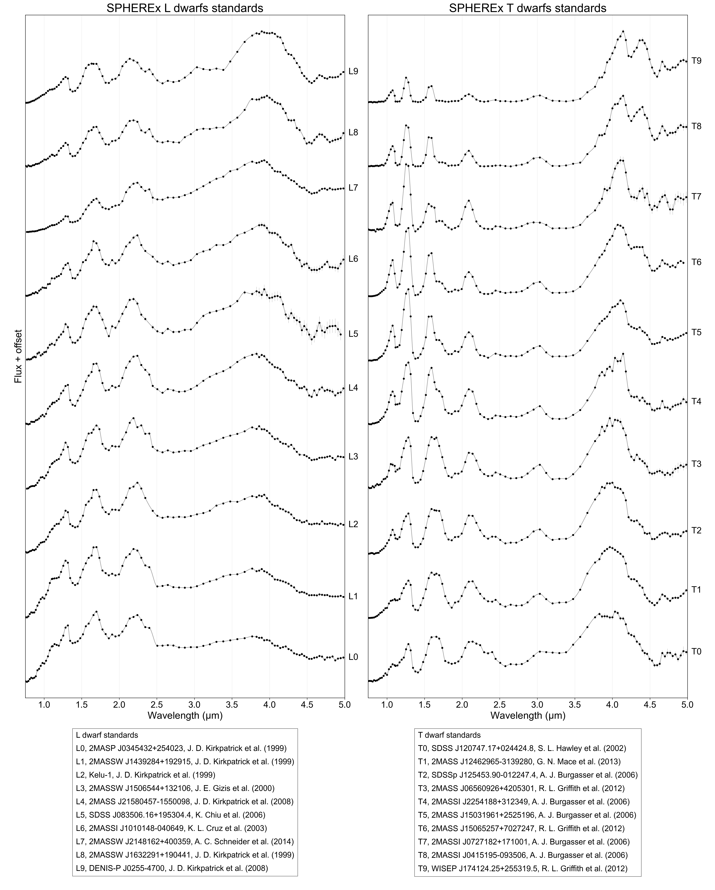
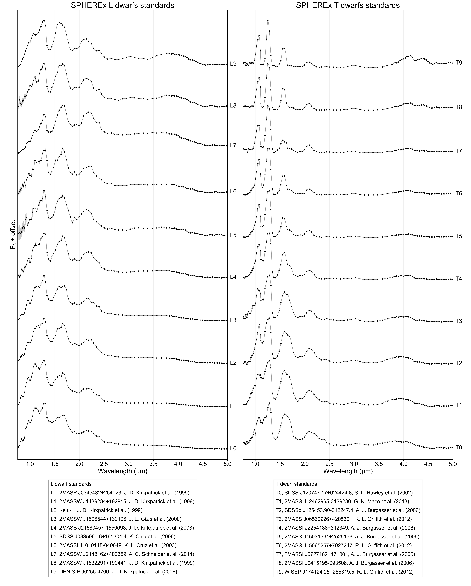

# SPExPI — SPHEREx Spectrum Extraction Pipeline

<p align="center">

</p>

SPExPI is a Python toolkit for extracting and inspecting low-resolution SPHEREx spectrophotometry of point sources. It
was designed around brown-dwarf and ultracool-dwarf use cases, including high proper-motion targets, but the core
pipeline can be applied to any isolated point source covered by SPHEREx image products.

The repository contains three main workflows:

1. **Spectrum extraction** with aperture photometry, PSF photometry, or both in a single run.
2. **Spectrum comparison** against a library of template spectra.
3. **Image stacking and plotting** for visual inspection of SPHEREx cutouts.

The main extraction module is `spexpi.spherex_pipeline`. It queries or reads SPHEREx cutouts, applies calibration with
solid-angle pixel maps, performs aperture and/or PSF photometry, reduces spectral oversampling, and writes calibrated
FITS spectra and diagnostic plots.

---

## Contents

- [Introduction](#introduction)
- [Pipeline description](#pipeline-description)
- [Repository layout](#repository-layout)
- [Installation](#installation)
- [Quick-start examples](#quick-start-examples)
    - [Run the SPHEREx pipeline](#a-run-the-spherex-pipeline)
    - [Compare an observed spectrum to templates](#b-compare-an-observed-spectrum-to-templates)
    - [Stack and plot images](#c-stack-and-plot-images)
- [Outputs](#outputs)
- [Complete API documentation](#complete-api-documentation)
- [Configuration reference](#configuration-reference)
- [Recommended workflow](#recommended-workflow)
- [Troubleshooting](#troubleshooting)
- [Acknowledgements](#acknowledgements)

---

## Introduction

SPHEREx produces spectral-image data rather than a ready-made 1D spectrum for every object. To build a source spectrum,
one must identify all relevant image products, extract flux measurements at the source position, apply detector
calibration, and combine measurements into a wavelength-ordered spectrum.

SPExPI automates this workflow. It can:

- query IRSA TAP for SPHEREx image cutouts;
- reuse locally cached FITS cutouts;
- infer the SPHEREx data release from URLs, local paths, or FITS headers;
- stamp the inferred data release into cached FITS files using the `DATAREL` keyword;
- propagate target coordinates to each exposure epoch using proper motion;
- convert detector images and variance maps to flux units using SPHEREx solid-angle pixel maps;
- perform aperture photometry with local annulus background subtraction;
- perform PSF photometry with optional centroid grid search;
- run aperture and PSF extraction in the same pipeline execution with `photometry_method="both"`;
- optionally reduce spectral oversampling using SPHEREx `spectral_channels` calibration files;
- write final FITS spectra, diagnostic plots, raw measurements, and processing manifests.

The code is intentionally script-friendly. The included top-level scripts (`run_spherex_pipeline.py`,
`compare_spectra.py`, and `plot_images.py`) can be used directly or adapted into notebooks and larger batch-processing
workflows.

---

## Pipeline description

### 1. Target definition

A target is defined by:

- right ascension and declination in degrees;
- an optional object name;
- optional proper motion in `mas/yr`;
- optional reference epoch as a decimal year.

When `reference_epoch_yr`, `pmra_masyr`, and `pmdec_masyr` are supplied, the pipeline projects the coordinates to each
exposure epoch before extracting flux. This is important for high proper-motion sources such as nearby ultracool dwarfs.

### 2. Cutout discovery and caching

The pipeline supports two input modes:

- `query_irsa_for_cutouts=True`: query IRSA TAP, download or extract cutouts, and cache them locally.
- `query_irsa_for_cutouts=False`: skip the IRSA query and read already cached FITS files from
  `download_dir/<object_name>/`.

Downloads can use:

- `download_backend="http"`: IRSA HTTP cutout download.
- `download_backend="s3_cutout"`: direct S3 parent-image access followed by local cutout extraction.

The HTTP mode is usually the fastest and most practical when IRSA is available because the server returns only the
requested cutout. The S3 mode is useful as a fallback or for workflows where direct archive access is required, but it
can be slower because remote FITS access may require reading large portions of the parent file.

### 3. Data release handling

The pipeline is designed to be release-aware without requiring a user-facing `data_release` parameter. It attempts to
infer the release from:

1. the original IRSA URL or S3 key;
2. the local cached file path;
3. FITS header keywords such as `DATAREL`, `OBS_COLLECTION`, `COLLECTION`, or related variants.

When possible, downloaded FITS files are stamped with:

```text
DATAREL = <release>
```

This makes cached runs self-contained even when the original URL is no longer available.

### 4. Calibration

SPHEREx image data are converted to calibrated per-pixel fluxes using solid-angle pixel maps (SAPM). SAPM files are
downloaded from the public SPHEREx S3 bucket and cached locally. The cache is grouped by inferred data release and
calibration collection.

The pipeline can also use `spectral_channels` calibration files to reduce oversampling in a detector-aware way. If
enabled, these files define wavelength-channel centers and edges used to bin repeated measurements.

### 5. Aperture photometry

Aperture photometry is performed on calibrated cutout images. The source aperture is centered on the epoch-adjusted
target position. A local annulus is used to estimate the background, with configurable sigma clipping and background
estimator (`mean`, `median`, or `mode`).

The pipeline can measure multiple aperture radii for diagnostics but builds the final aperture spectrum from
`selected_aperture_radius_pix`.

### 6. PSF photometry

PSF photometry extracts a SPHEREx PSF kernel from the calibration information contained in the cutout file. The PSF is
shifted to the subpixel source position and fitted with a weighted linear model.

Optional local grid search can refine the centroid around the WCS-predicted position. This is controlled by:

- `enable_psf_local_grid_search`
- `psf_local_grid_half_range_pix`
- `psf_local_grid_step_pix`
- `psf_local_grid_metric`
- `psf_grid_search_enabled_detectors`

The grid-search metric can be `snr` or `chi2`.

### 7. Spectrum construction

Each successful photometric measurement contributes a wavelength, flux, uncertainty, detector, and diagnostic metadata.
The spectrum table contains:

- `WAVELENGTH`
- `FLUX`
- `ERR`
- `DETECTOR`

Outlier rejection can be applied detector-by-detector in wavelength bins. Oversampling reduction can then be applied
using either hard-coded detector bins or `spectral_channels` calibration files.

### 8. Output metadata

The final spectrum FITS header stores useful metadata, including:

- input target coordinates;
- inferred SPHEREx data release;
- mean epoch-adjusted coordinates;
- coordinate scatter diagnostics;
- proper-motion settings when supplied.

---

## Repository layout

```text
src
├── compare_spectra.py
├── plot_images.py
├── plot_sequence.py
├── run_spherex_pipeline.py
└── spexpi/
    ├── __init__.py
    ├── image_plotter.py
    ├── image_stacker.py
    ├── shared.py
    ├── spectrum_comparator.py
    ├── spectrum_plotter.py
    └── spherex_pipeline.py
```

Main modules:

- `spexpi.spherex_pipeline`: SPHEREx cutout retrieval, photometry, calibration, spectrum generation.
- `spexpi.spectrum_comparator`: observed spectrum versus template matching.
- `spexpi.spectrum_plotter`: comparison plot creation.
- `spexpi.image_stacker`: detector-wise image stacking.
- `spexpi.image_plotter`: multi-panel image visualization.
- `spexpi.shared`: small shared helpers.

---

## Installation

### 1. Clone the repository

```bash
git clone https://github.com/fkiwy/spexpi.git
cd spexpi
```

### 2. Create a virtual environment

```bash
python -m venv .venv
```

Activate it:

```bash
# Linux / macOS
source .venv/bin/activate

# Windows cmd
.venv\Scripts\activate.bat
```

### 3. Install the package

```bash
pip install .
```

### 4. Optional plotting/image dependencies

The `image_stacker` module uses `reproject` for WCS reprojection. It is included in the recommended dependencies in the
`pyproject.toml` below. If you do not plan to stack images, the core spectrum extraction tools can still be used without
calling that module.

---

## Quick-start examples

The examples below use the test case already present in the repository scripts:

```text
T2 SIMP J013656.5+093347.3
RA  = 24.2412498 deg
Dec =  9.5630705 deg
pmRA  = 1238.244 mas/yr
pmDec =  -16.156 mas/yr
reference epoch = 2016.0
```

### a) Run the SPHEREx pipeline

This example is based on `run_spherex_pipeline.py`.

```python
from astropy.time import Time

from spexpi.spherex_pipeline import PipelineConfig, run_spherex_pipeline

# ------------------------------------------------------
# Target: T2 SIMP J013656.5+093347.3
# ------------------------------------------------------
object_name = "T2 SIMP J013656.5+093347.3"
ra, dec = 24.2412498, 9.5630705
pmra, pmdec = 1238.244, -16.156
ref_epoch = 2016.0

cfg = PipelineConfig(
    # Photometry mode: "aperture", "psf", or "both".
    # "both" writes independent aperture and PSF spectra/plots in one run.
    photometry_method="both",

    # Aperture photometry
    selected_aperture_radius_pix=2.0,
    aperture_radii_pix=(1.0, 2.0, 3.0),

    # PSF photometry
    psf_kernel_radius_native=5,
    psf_shift_sign=1.0,
    psf_fit_background_gradient=False,
    enable_psf_local_grid_search=True,
    psf_local_grid_half_range_pix=1.0,
    psf_local_grid_step_pix=0.25,
    psf_local_grid_metric="snr",
    psf_grid_search_enabled_detectors=(1, 2, 3, 4, 5, 6),

    # Spectrum cleaning and binning
    remove_outliers=True,
    outlier_detectors=(1, 2, 3, 4, 5, 6),
    outlier_nbr_of_bins=8,
    keep_negative_flux=True,
    reduce_oversampling=True,
    use_spectral_channels_for_binning=True,
    spectral_channels_bin_by="integrate",
    spectral_channels_min_points_per_bin=1,
    spectral_channels_collection="cal-sch-v1-2026-106",

    # Download/cache settings
    cutout_size_arcsec=120,
    max_workers=8,
    download_backend="http",
    download_dir="../resources/objects/data",
    redownload_existing_files=False,
    query_irsa_for_cutouts=True,
    cached_cutout_glob="*.fits",

    # Calibration cache settings
    sapm_cache_dir="../resources/spherex_calibration_files/spherex_sapm_cache",
    redownload_sapm_files=False,
    sapm_collection="cal-sapm-v2-2025-164",
    spectral_channels_cache_dir="../resources/spherex_calibration_files/spherex_spectral_channels_cache",
    redownload_spectral_channels=False,

    # Outputs
    output_dir="../resources/objects/spectra",
    plot_spectrum=True,
    save_raw_measurements=False,
    save_manifest=False,

    # Proper motion propagation
    reference_epoch_yr=ref_epoch,
    pmra_masyr=pmra,
    pmdec_masyr=pmdec,
)

spectra, measurements = run_spherex_pipeline(
    ra,
    dec,
    object_name=object_name,
    cfg=cfg,
)
```

Expected products include:

```text
../resources/objects/spectra/fits/T2 SIMP J013656.5+093347.3_aperture_spectrum.fits
../resources/objects/spectra/fits/T2 SIMP J013656.5+093347.3_psf_spectrum.fits
../resources/objects/spectra/plots/T2 SIMP J013656.5+093347.3_aperture_spectrum.pdf
../resources/objects/spectra/plots/T2 SIMP J013656.5+093347.3_psf_spectrum.pdf
```

Spectrum plots:


When `photometry_method="aperture"` or `photometry_method="psf"`, the first return value is a single
`astropy.table.Table`. When `photometry_method="both"`, the first return value is a dictionary with keys such as
`"aperture"` and `"psf"`.

### b) Compare an observed spectrum to templates

This example is based on `compare_spectra.py`. It loads a set of template FITS spectra, creates `Spectrum` objects,
compares an observed spectrum to templates using reduced chi-square, and plots the best matches.

```python
import os
import warnings

import astropy.units as u
from astropy.io import fits

from spexpi.spectrum_comparator import Spectrum, SpectrumTemplateComparator
from spexpi.spectrum_plotter import create_comparison_plot


def extract_spectrum_from_fits(fits_file_path):
    with fits.open(fits_file_path) as hdul:
        data = hdul[1].data
        wavelength = data["WAVELENGTH"]
        flux = data["FLUX"]
        error = data["ERR"]
        return wavelength, flux, error


warnings.simplefilter("ignore", category=Warning)

wl_unit = u.um
flux_unit = u.Jy

# Load template spectra
standards_dir = "../resources/standards/sequence/psf"
templates = []

for filename in sorted(f for f in os.listdir(standards_dir) if f.endswith(".fits")):
    full_path = os.path.join(standards_dir, filename)
    wavelength, flux, flux_error = extract_spectrum_from_fits(full_path)

    spt = filename.split()[0].replace("_", "")

    template = Spectrum(
        wavelength=wavelength * wl_unit,
        flux=flux * flux_unit,
        uncertainty=flux_error * flux_unit,
        label=spt,
        model_params={"spt": spt},
    )
    templates.append(template)

# Load observed spectrum
object_name = "T2 SIMP J013656.5+093347.3"
fits_path = "../resources/objects/spectra/fits/T2 SIMP J013656.5+093347.3_psf_spectrum.fits"

wavelength, flux, flux_error = extract_spectrum_from_fits(fits_path)

observed = Spectrum(
    label=object_name,
    wavelength=wavelength * wl_unit,
    flux=flux * flux_unit,
    uncertainty=flux_error * flux_unit,
)

# Compare observed spectrum to templates
comparator = SpectrumTemplateComparator()
result = comparator.compare(
    observed,
    templates,
    trim_wave=True,
    number_of_matches=3,
    metric="reduced-chi2",
    normalize=True,
    scaling_mode="least-squares",
)

print("Best match:", result.best_match.template_original.label)
print("Statistic:", result.best_match.statistic)

# Plot comparison
create_comparison_plot(
    result,
    object_name=object_name,
    output_dir="../resources/objects/spectra/plots",
    plot_format="pdf",
    plot_observed_error=True,
    plot_template_error=False,
)
```

Supported comparison metrics include:

- `reduced-chi2`
- `chi2`
- `cosine`

Supported scaling modes include:

- `least-squares`
- `original`
- `none`

Comparison plot:


Spectral standards used for comparison:



Same as above in units of `F_lambda`:



### c) Stack and plot images

This example is based on `plot_images.py`. It creates stacked detector images for visual inspection and then generates a
multi-panel diagnostic image plot.

```python
import warnings

from spexpi.image_plotter import plot_images
from spexpi.image_stacker import stack_images

warnings.filterwarnings("ignore")

# Target: T2 SIMP J013656.5+093347.3
ra, dec = 24.2455, 9.5625
object_name = "T2 SIMP J013656.5+093347.3"

image_size_arcsec = 100
data_dir = "../resources/objects/data/" + object_name.replace(" ", "_")
output_dir = "../resources/objects/images_v2"

images = stack_images(
    ra,
    dec,
    data_dir,
    output_dir,
    object_name,
    image_size_arcsec,
    save_fits=True,
    verbose=False,
)

plot_images(
    ra,
    dec,
    images,
    image_size_arcsec,
    image_contrast=10,
    object_name=object_name,
    output_dir=output_dir,
    open_plot=True,
    plot_format="pdf",
)
```

The image workflow is useful for checking whether the target is centered, whether nearby sources contaminate the
aperture, and whether a detector-specific issue is present.

Images plot:


---

## Outputs

### Spectrum FITS files

The pipeline writes one FITS spectrum per selected method:

```text
<object_name>_aperture_spectrum.fits
<object_name>_psf_spectrum.fits
```

The binary table contains:

| Column       |    Unit | Description                                        |
|--------------|--------:|----------------------------------------------------|
| `WAVELENGTH` |      um | SPHEREx wavelength sample or binned channel center |
| `FLUX`       |      Jy | Extracted flux density                             |
| `ERR`        |      Jy | Flux uncertainty                                   |
| `DETECTOR`   | integer | SPHEREx detector number                            |

The primary header contains target and pipeline metadata, including inferred data release and epoch-adjusted coordinate
statistics when available.

### Diagnostic plots

Plots are saved to:

```text
<output_dir>/plots/
```

The plotting unit is controlled by `plot_flux_lambda`:

- `True`: plot in `F_lambda`.
- `False`: plot the stored `F_nu` values.

### Measurement FITS table

If `save_raw_measurements=True`, the pipeline writes all per-cutout photometry measurements to:

```text
<output_dir>/fits/<object_name>_measurements.fits
```

### Manifests

If `save_manifest=True`, CSV and/or JSONL manifest files are written. These record cutout provenance, inferred data
release, download status, projection diagnostics, and measurement-level metadata.

---

## Complete API documentation

This section documents the public and semi-public functions in the repository. Functions beginning with an underscore
are implementation details and are not normally called by users.

### `spexpi.spherex_pipeline`

#### `PipelineConfig`

Dataclass storing all pipeline configuration parameters. See [Configuration reference](#configuration-reference) for the
full list.

#### `run_spherex_pipeline(ra, dec, object_name=None, cfg=None)`

Run the full SPHEREx extraction pipeline.

Parameters:

- `ra` (`float`): input right ascension in degrees.
- `dec` (`float`): input declination in degrees.
- `object_name` (`str | None`): target name used for cache/output filenames. If omitted, a name is generated from
  coordinates.
- `cfg` (`PipelineConfig | None`): configuration. If omitted, defaults are used.

Returns:

- `(spectrum, measurements)` for `photometry_method="aperture"` or `"psf"`.
- `(spectra, measurements)` for `photometry_method="both"`, where `spectra` is a dictionary keyed by method name.

#### `validate_config(cfg)`

Validate key configuration values before running the pipeline. Raises `ValueError` for invalid photometry mode, backend,
background method, or related settings.

#### `query_spherex_cutouts(ra, dec, cfg)`

Query IRSA TAP for SPHEREx image products covering the target. Returns an `astropy.table.Table` containing cutout URLs
and metadata.

#### `download_cutout_files_parallel(cutout_table, object_name, cfg, ra=None, dec=None)`

Download or extract all cutouts listed in an IRSA result table. Uses a thread pool and returns dictionaries describing
local file paths, download status, and inferred data release.

#### `prepare_cached_cutout_rows(object_name, cfg)`

Build row dictionaries from already cached FITS files in `download_dir/<object_name>/`.

#### `open_cutouts_parallel(prepared_rows, ra, dec, cfg)`

Open all cached FITS files, read relevant extensions, compute epoch-adjusted source coordinates, infer data release, and
return cutout dictionaries.

#### `process_cutout_row(row, ra, dec, cfg)`

Open one FITS cutout and build the in-memory representation needed for photometry. This includes `IMAGE`, `FLAGS`,
`VARIANCE`, optional `ZODI`, optional `PSF`, detector number, wavelength, projected source position, and release
metadata.

#### `measure_cutout_photometry(row, sapm_cache, cfg)`

Measure aperture and/or PSF fluxes for a single cutout. Returns one or more measurement dictionaries.

#### `build_spectrum_table(measurements, aperture_radius_pix, photometry_method="aperture")`

Select valid measurements and convert them into a raw spectrum table.

#### `process_spectrum_table(spec, cfg)`

Apply final cleaning, optional outlier rejection, and optional oversampling reduction.

#### `save_spectrum_fits(spec, ra, dec, object_name, cfg, photometry_method=None, coord_stats=None)`

Write a processed spectrum to a FITS file. The output filename includes the photometry method.

#### `plot_spectrum(spec, object_name, cfg, photometry_method=None)`

Create a diagnostic spectrum plot.

#### `save_measurements_fits(measurements, object_name, cfg)`

Save per-cutout measurements to FITS.

#### `append_manifest_rows(rows, object_name, cfg, basename="processing_manifest")`

Write CSV and/or JSONL manifest files.

#### `project_to_epoch(ref_ra_deg, ref_dec_deg, ref_epoch_yr, pmra_masyr, pmdec_masyr, target_mjd)`

Project input coordinates to an exposure epoch. Returns epoch-adjusted RA, Dec, and a status string.

#### `compute_epoch_adjusted_coordinate_stats(cutouts)`

Compute mean and scatter statistics for epoch-adjusted coordinates.

#### `add_epoch_adjusted_coordinate_header(header, stats)`

Write epoch-adjusted coordinate statistics into a FITS header.

#### `flux_to_flux_lambda(wavelength, flux, density_unit=u.AA)`

Convert flux density to `F_lambda` at a given wavelength using Astropy spectral-density equivalencies.

#### `infer_data_release_from_uri(uri)`, `infer_data_release_from_header(header)`, `infer_data_release_from_fits(path)`

Infer the SPHEREx data release from a URL/path, FITS header, or FITS file.

#### `stamp_data_release_in_fits(path, data_release)`

Write the inferred `DATAREL` keyword into all FITS HDUs where possible.

#### `load_sapm(detector, cfg, data_release)`

Load and cache the solid-angle pixel map for a detector and data release.

#### `load_spectral_channels_calibration(cfg, data_release=None)`

Load the SPHEREx `spectral_channels` calibration table for oversampling reduction.

#### `reduce_oversampling_with_spectral_channels(wl, flux, err, det, channels_table, cfg)`

Bin measurements using detector-specific `spectral_channels` calibration.

#### `reduce_oversampling_per_detector(wl, flux, err, det)`

Fallback oversampling reduction using hard-coded detector ranges and resolving powers.

---

### `spexpi.spectrum_comparator`

#### `Spectrum`

Dataclass representing one spectrum.

Fields:

- `wavelength`: wavelength array, typically with Astropy units.
- `flux`: flux array, typically with Astropy units.
- `uncertainty`: optional flux uncertainty array.
- `label`: display label.
- `metadata`: arbitrary metadata dictionary.
- `model_params`: optional model/template parameter dictionary.

Methods:

- `copy()`: deep-ish copy of the spectrum arrays and metadata.
- `sort_by_wavelength()`: return a copy sorted by wavelength.
- `trim(min_wave=None, max_wave=None)`: return a wavelength-trimmed copy.

#### `MatchResult`

Dataclass describing one template match.

Fields:

- `statistic`: comparison statistic.
- `metric`: metric name.
- `observed`: observed spectrum.
- `template_original`: original template spectrum.
- `template_scaled`: scaled/interpolated template.
- `scale_factor`: applied multiplicative scale.
- `offset`: applied additive offset.

#### `ComparisonResult`

Dataclass containing all comparison results.

Fields:

- `observed`: observed spectrum.
- `best_matches`: list of best `MatchResult` objects.
- `metric`: comparison metric.
- `scaling_mode`: scaling mode.
- `all_results`: complete result list.

Property:

- `best_match`: first element of `best_matches`.

#### `SpectrumTemplateComparator.compare(...)`

Compare an observed spectrum to a list of templates.

```python
result = comparator.compare(
    reference,
    templates,
    number_of_matches=3,
    metric="reduced-chi2",
    trim_wave=True,
    normalize=True,
    scaling_mode="least-squares",
)
```

Parameters:

- `reference`: observed `Spectrum`.
- `templates`: list of template `Spectrum` objects.
- `number_of_matches`: number of top matches returned.
- `metric`: `"reduced-chi2"`, `"chi2"`, or `"cosine"`.
- `trim_wave`: restrict comparison to overlapping wavelength range.
- `normalize`: apply normalization before scoring.
- `scaling_mode`: template scaling method.

---

### `spexpi.spectrum_plotter`

#### `create_comparison_plot(...)`

Create a multi-panel or stacked comparison plot from a `ComparisonResult`.

Important parameters:

- `comparison_result`: output from `SpectrumTemplateComparator.compare()`.
- `object_name`: target name used in plot title and filename.
- `output_dir`: output directory.
- `plot_format`: file format, e.g. `"pdf"` or `"png"`.
- `plot_observed_error`: show observed error bars.
- `plot_template_error`: show template error bars.
- `offset_step`: vertical offset between matches.
- `max_matches`: maximum number of matches plotted.

#### `jy_to_flambda(wavelength_um, flux_jy)`

Convert Jy to `F_lambda`.

#### `plot_curves(ax, wl, flux, err, color, ...)`

Plot a curve with optional error bars and interpolation.

---

### `spexpi.image_stacker`

#### `stack_images(...)`

Stack SPHEREx image cutouts by detector.

```python
images = stack_images(
    ra,
    dec,
    data_dir,
    output_dir,
    object_name,
    image_size_arcsec=100,
    save_fits=True,
)
```

Parameters:

- `ra`, `dec`: target coordinates in degrees.
- `data_dir`: directory containing FITS cutouts.
- `output_dir`: output directory.
- `object_name`: target name.
- `image_size_arcsec`: cutout size for stacked images.
- `save_fits`: write stacked FITS outputs.
- `aperture_radius_pix`: radius used for overlay diagnostics.
- `background_inner_radius_pix`: inner annulus radius for overlay diagnostics.
- `background_outer_radius_pix`: outer annulus radius for overlay diagnostics.
- `fatal_flag_bits`: bit flags excluded from stacking.
- `include_reference_image`: include a reference image in output list.
- `overwrite`: overwrite stacked FITS files.
- `verbose`: print progress.

Returns a sequence of image dictionaries compatible with `plot_images()`.

---

### `spexpi.image_plotter`

#### `plot_images(...)`

Create a multi-panel diagnostic plot from stacked images.

```python
plot_images(
    ra,
    dec,
    images,
    image_size=100,
    image_contrast=10,
    object_name="T2 SIMP J013656.5+093347.3",
    output_dir="../resources/objects/images_v2",
    open_plot=True,
    plot_format="pdf",
)
```

Parameters:

- `ra`, `dec`: target coordinates in degrees.
- `images`: sequence returned by `stack_images()`.
- `image_size`: displayed image size in arcseconds.
- `image_contrast`: contrast scaling parameter.
- `object_name`: used for labels and output filename.
- `output_dir`: output directory.
- `save_plot`: save the plot to disk.
- `open_plot`: open the plot after saving.
- `plot_format`: output format.

#### `ImageCutout`

Dataclass representing one image panel.

Fields:

- `band`: detector or color-panel label.
- `hdu`: FITS HDU object.
- `phot_radii`: aperture/background radii to draw.

#### `PlotConfig`

Dataclass controlling internal plotting layout.

Fields:

- `image_contrast`
- `rows`
- `cols`
- `figure_size`
- `label_fontsize`
- `info_fontsize`
- `dpi`

---

### `spexpi.shared`

#### `open_file(filename)`

Open a file using the platform default application.

#### `create_object_name(ra, dec, precision=0, sep="", prefix=None, shortform=False, decimal=True)`

Create a compact object name from coordinates.

---

## Configuration reference

`PipelineConfig` contains many options. The most commonly edited options are shown below.

### IRSA and parallel processing

| Parameter            |                             Default | Description                     |
|----------------------|------------------------------------:|---------------------------------|
| `tap_url`            | `https://irsa.ipac.caltech.edu/TAP` | IRSA TAP service URL.           |
| `cutout_size_arcsec` |                               `180` | HTTP cutout size in arcseconds. |
| `max_workers`        |                                 `8` | Number of parallel workers.     |
| `retries`            |                                 `3` | Download/open retry count.      |
| `retry_delay_sec`    |                               `5.0` | Delay between retries.          |

### Proper motion

| Parameter              | Default | Description                                         |
|------------------------|--------:|-----------------------------------------------------|
| `reference_epoch_yr`   |  `None` | Coordinate reference epoch as decimal year.         |
| `pmra_masyr`           |  `None` | Proper motion in RA, `mu_alpha*cos(delta)`, mas/yr. |
| `pmdec_masyr`          |  `None` | Proper motion in Dec, mas/yr.                       |
| `log_epoch_projection` | `False` | Print projected coordinates per cutout.             |

### Download and cache

| Parameter                    |             Default | Description                             |
|------------------------------|--------------------:|-----------------------------------------|
| `download_dir`               | `spherex_downloads` | Cached cutout directory.                |
| `redownload_existing_files`  |             `False` | Replace existing cached FITS files.     |
| `show_download_progress`     |              `True` | Show progress bars.                     |
| `request_timeout_sec`        |             `120.0` | HTTP timeout.                           |
| `download_backend`           |              `http` | `http`, `s3`, or `s3_cutout`.           |
| `s3_bucket`                  | `nasa-irsa-spherex` | Public SPHEREx S3 bucket.               |
| `s3_cutout_size_px`          |                `32` | S3 local cutout size in pixels.         |
| `s3_cutout_fallback_to_http` |              `True` | Fall back to HTTP if S3 fails.          |
| `query_irsa_for_cutouts`     |              `True` | Query IRSA; if false, use cached files. |
| `cached_cutout_glob`         |            `*.fits` | Glob for cached local files.            |

### Calibration

| Parameter                           |                                                     Default | Description                          |
|-------------------------------------|------------------------------------------------------------:|--------------------------------------|
| `cache_sapm_files`                  |                                                      `True` | Cache SAPM calibration files.        |
| `sapm_cache_dir`                    |              `spherex_calibration_files/spherex_sapm_cache` | SAPM cache directory.                |
| `redownload_sapm_files`             |                                                     `False` | Refresh SAPM files.                  |
| `sapm_collection`                   |                                      `cal-sapm-v2-2025-164` | SAPM collection.                     |
| `use_spectral_channels_for_binning` |                                                     `False` | Use `spectral_channels` for binning. |
| `spectral_channels_collection`      |                                       `cal-sch-v1-2026-106` | Spectral-channel collection.         |
| `spectral_channels_cache_dir`       | `spherex_calibration_files/spherex_spectral_channels_cache` | Spectral-channel cache.              |

### Aperture photometry

| Parameter                      |           Default | Description                              |
|--------------------------------|------------------:|------------------------------------------|
| `aperture_radii_pix`           | `(1.0, 2.0, 3.0)` | Aperture radii measured.                 |
| `selected_aperture_radius_pix` |             `2.0` | Radius used for final aperture spectrum. |
| `annulus_inner_scale`          |             `2.0` | Inner annulus radius multiplier.         |
| `annulus_outer_scale`          |             `3.0` | Outer annulus radius multiplier.         |
| `bg_method`                    |          `median` | Background estimator.                    |
| `sigma_clip_sigma`             |             `3.0` | Background sigma-clipping threshold.     |
| `subtract_zodi`                |            `True` | Subtract ZODI extension if present.      |

### PSF photometry

| Parameter                       |    Default | Description                         |
|---------------------------------|-----------:|-------------------------------------|
| `photometry_method`             | `aperture` | `aperture`, `psf`, or `both`.       |
| `psf_kernel_radius_native`      |        `5` | PSF kernel half-size.               |
| `psf_shift_sign`                |      `1.0` | Subpixel shift convention.          |
| `psf_fit_background_gradient`   |    `False` | Include background gradient in fit. |
| `psf_min_valid_pixels`          |        `6` | Minimum pixels for PSF fit.         |
| `psf_max_reduced_chi2`          |     `None` | Optional PSF chi-square rejection.  |
| `enable_psf_local_grid_search`  |     `True` | Enable centroid grid search.        |
| `psf_local_grid_half_range_pix` |      `1.0` | Search half-range.                  |
| `psf_local_grid_step_pix`       |      `0.5` | Search step size.                   |
| `psf_local_grid_metric`         |      `snr` | `snr` or `chi2`.                    |

### Cleaning and binning

| Parameter                  |         Default | Description                                         |
|----------------------------|----------------:|-----------------------------------------------------|
| `sanitize_flux`            |          `True` | Remove non-finite values and invalid uncertainties. |
| `keep_negative_flux`       |          `True` | Keep negative faint-source flux points.             |
| `remove_outliers`          |          `True` | Detector-wise outlier rejection.                    |
| `outlier_detectors`        | `(1,2,3,4,5,6)` | Detectors to clean.                                 |
| `outlier_nbr_of_bins`      |             `8` | Bins per detector for clipping.                     |
| `outlier_sigma`            |           `3.0` | MAD clipping threshold.                             |
| `reduce_oversampling`      |          `True` | Reduce repeated wavelength sampling.                |
| `spectral_channels_bin_by` |     `integrate` | `integrate`, `edges`, `nearest`, or `auto`.         |

### Outputs

| Parameter               |           Default | Description                               |
|-------------------------|------------------:|-------------------------------------------|
| `output_dir`            | `spherex_spectra` | Output root.                              |
| `save_raw_measurements` |           `False` | Save measurement FITS table.              |
| `save_manifest`         |           `False` | Save CSV/JSONL manifests.                 |
| `manifest_format`       |            `both` | `csv`, `jsonl`, `both`, or `none`.        |
| `plot_flux_lambda`      |            `True` | Plot as `F_lambda` rather than stored Jy. |
| `plot_spectrum`         |            `True` | Save diagnostic plot.                     |
| `plot_format`           |             `pdf` | Plot format.                              |
| `plot_color`            |               `k` | Plot color.                               |

---

## Recommended workflow

1. Start with `photometry_method="both"` for a new object.
2. If the object has high proper motion, provide `reference_epoch_yr`, `pmra_masyr`, and `pmdec_masyr`.
3. Inspect the aperture and PSF spectra.
4. Use `plot_images.py` to check centering and contamination.
5. Enable `use_spectral_channels_for_binning=True` for final spectra.
6. Use `save_raw_measurements=True` and `save_manifest=True` when debugging or preparing reproducible products.

---

## Troubleshooting

### IRSA is unavailable

Use cached files if already downloaded:

```python
cfg.query_irsa_for_cutouts = False
```

Or try S3 extraction:

```python
cfg.download_backend = "s3_cutout"
cfg.s3_cutout_fallback_to_http = True
```

Note that direct S3 FITS access can be much slower than IRSA HTTP cutouts because the server-side cutout service only
returns the requested region.

### Data release cannot be inferred

Recent versions of the pipeline stamp `DATAREL` into downloaded FITS headers. If older cached files lack this keyword
and their paths do not include a release name, redownload the cutouts or move them under a directory that includes the
release name, such as:

```text
data/qr2/<object_name>/
```

### PSF spectrum is noisy

Try:

```python
cfg.enable_psf_local_grid_search = True
cfg.psf_local_grid_metric = "snr"
cfg.psf_local_grid_half_range_pix = 1.0
cfg.psf_local_grid_step_pix = 0.25
```

### Aperture and PSF disagree

Check:

- stacked images;
- nearby contaminating sources;
- source centering;
- background annulus settings;
- detector-specific outliers.

---

## Acknowledgements

This package uses SPHEREx mission data products and calibration files distributed through IRSA and the public SPHEREx
archive. It also relies on the Python scientific ecosystem, including Astropy, NumPy, SciPy, Matplotlib, Photutils,
PyVO, and related packages.

